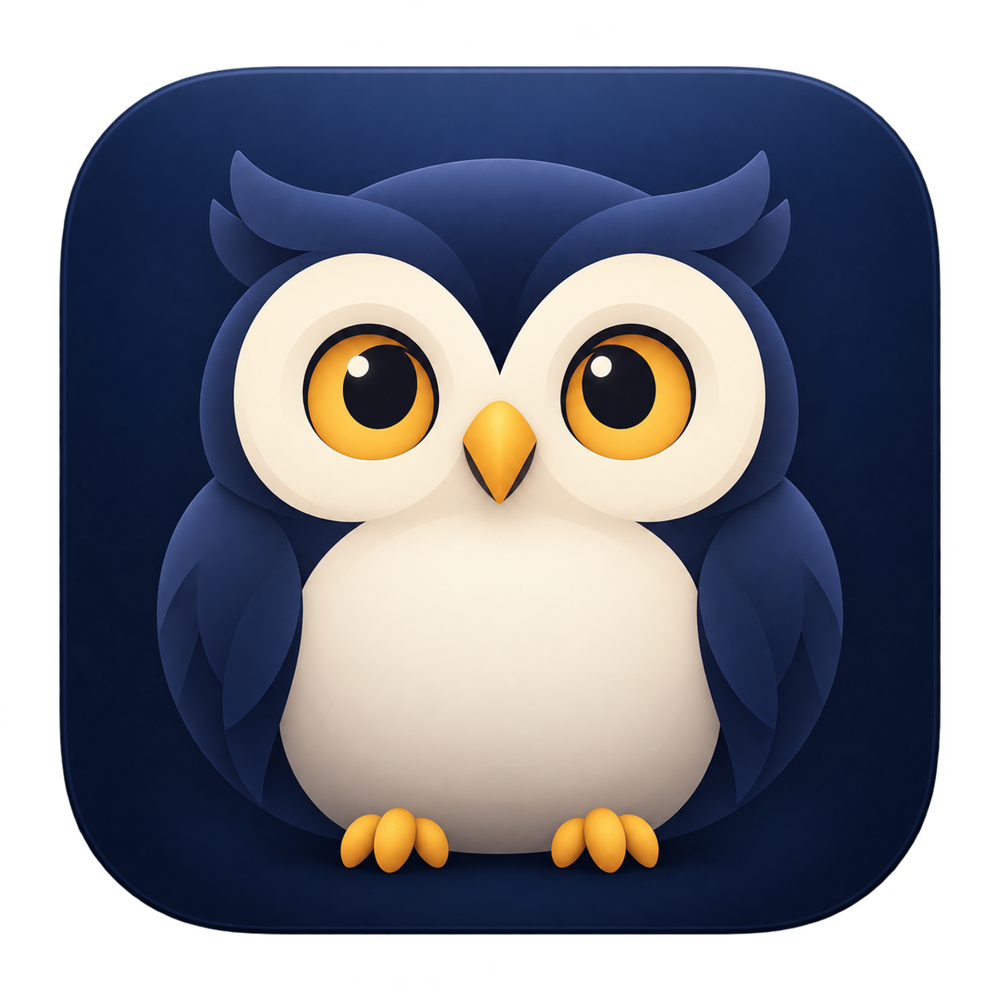

<p align="center">
  
</p>

# Nightshift

**Keep your Mac awake while your agents work.**

Nightshift is a native macOS menu bar utility with built-in agent detection. It tracks running work across compatible terminal, editor, and desktop hosts, prevents idle system sleep, and releases protection when the last agent finishes or needs you. The display can still sleep.

[Quick start](#quick-start) · [Universal integration](#universal-integration) · [Closed-lid protection](#closed-lid-protection) · [Configuration](#configuration) · [Development](#development)

## Highlights

- **Activity-aware wakefulness** — tracks concurrent sessions and independent subagents, with a short completion grace period.
- **Status at a glance** — a colored owl shows whether sleep prevention is active, needs attention, or is released.
- **Built-in universal integration** — one local lifecycle-event receiver for compatible hosts, with setup for Claude Code and Codex and an adapter for other agents.
- **Built-in recovery** — process-identity checks and bounded transcript tailing recover missed completions and interruptions, including after an app restart.
- **Closed-lid protection** — an optional administrator-installed helper follows task activity and restores the previous power setting afterwards.
- **Local operation** — Swift, AppKit, and IOKit, with no external Swift packages or cloud account.

## Requirements

- **macOS 13 (Ventura) or later.** Windows and Linux are unsupported.
- Apple command-line developer tools (`swiftc`, `codesign`, and the macOS SDK). Install them with `xcode-select --install` if needed.
- Python 3 for hook configuration and Python tests.
- An agent runtime that emits compatible lifecycle events. The included setup supports Claude Code and Codex; other agents can use the local adapter.

The build script targets the Mac running it. Existing verification covers Apple Silicon; Intel behavior has not been verified. Builds are ad-hoc signed, not notarized.

## Quick start

From the project root:

```sh
zsh scripts/build.sh
open dist/Nightshift.app
```

Nightshift appears in the menu bar, without a Dock icon or main window. The build creates `dist/Nightshift.app`; generated bundles are excluded from Git.

1. Choose **Enable Detection** in the first-launch setup, or open **Agent Detection → Set up agent detection…**. Nightshift configures Claude Code and Codex directly, with configuration backups and existing hooks preserved.
2. Restart your agent sessions. In Codex, review and trust newly installed hooks through `/hooks`.
3. Start an agent task and check the menu for its activity and wakefulness state.

Closed-lid protection is requested by default. Until its helper is installed and confirmed, active work can show yellow even though ordinary idle-sleep prevention works. You can disable the closed-lid option under **Wakefulness** if you only need open-lid operation.

Keep the app at a stable, writable location: by default, it stores `Nightshift Data` beside the bundle. If you move the app, rerun hook setup so hooks use its new executable path.

To start at login, add the app in **System Settings → General → Login Items**.

## Menu and status

| Owl | Meaning |
| --- | --- |
| Green | Nightshift holds its wake assertion and any requested closed-lid protection is confirmed. Also covers the completion grace period and manual override. |
| Yellow | A task needs input, a power error occurred, or requested closed-lid protection needs setup or confirmation. Check the menu for details. |
| Red | Nightshift allows normal sleep because it is idle or paused. Other apps may still prevent sleep. |

When some tasks work and others wait, active work takes priority, subject to power and closed-lid warnings. The display can sleep in every state.

| Menu | Controls |
| --- | --- |
| Status & details… | View wakefulness, task counts, detection health, and any warnings. |
| Tasks | Appears when tasks are present. Open task details or ignore a stale task until its next event. |
| Wakefulness | Pause or resume, keep awake for one hour, and manage closed-lid protection. |
| Agent Detection | Set up built-in detection, refresh sources, and open the setup guide. |
| Help & Diagnostics | Open diagnostics, Login Items settings, and app information. |

Quit releases Nightshift's idle-sleep assertion. Restart restores saved direct task state and revalidates process identity when available.

## Universal integration

Nightshift detects activity through **agent lifecycle hooks, owning-process checks, and incremental transcript recovery**. The detector runs inside Nightshift.

### Set up once

Use **Agent Detection → Set up agent detection…**, or run this from the project root after building:

```sh
python3 scripts/configure-hooks.py
```

The installer configures both Claude Code and Codex by default. It backs up configuration and preserves existing hooks. Restart agent sessions afterwards. In Codex, review and trust the new hooks through `/hooks`.

| Agent or host | Integration |
| --- | --- |
| Claude Code in compatible terminals, editors, and desktop hosts | Receives events wherever that runtime loads the configured Claude Code settings. |
| Codex CLI and compatible desktop/editor runtimes | Receives events wherever that runtime loads and trusts the configured Codex hooks. |
| Other coding agents and custom runners | Send lifecycle JSON to Nightshift's local event adapter below. |

“Universal” means a shared event interface across hosts. It does not mean that every application exposes agent activity automatically. A host with a separate configuration home needs its own setup. A desktop app being open is not proof that an agent is working.

### How detection works

1. A prompt, tool action, or subagent start delivers a small native hook event to Nightshift's private local inbox.
2. Nightshift tracks each session and subagent independently, keeping the Mac awake while any work remains. Explicit input and approval events distinguish waiting from working.
3. Process identity checks catch exited agents. When a hook supplies a transcript path, Nightshift reads bounded chunks of new JSONL records to recover explicit completion or interruption events that were missed while the app was closed or a hook failed.
4. Newer hooks and turn boundaries take precedence over older transcript records. A parent finishing never silently completes its independent subagents.
5. After the last task finishes, Nightshift releases its assertion following a three-second grace period.

Transcripts are used for terminal-state recovery, not to guess work from conversational text. A missing start event or a runtime without compatible events still requires an adapter. Long silence alone does not prove completion.

### Installer options

| Option | Purpose |
| --- | --- |
| `--provider codex` / `--provider claude` | Configure only one provider; the default is both. |
| `--app /absolute/path/Nightshift.app` | Point hooks at a bundle outside `dist/`. |
| `--data /absolute/path` | Set the hook data directory; configure the app to use the same directory. |
| `--dry-run` | Show configuration destinations without writing changes. |
| `--remove` | Remove Nightshift-managed hooks while preserving other hooks. |
| `--config-root /temporary/home` | Use an isolated configuration home for testing. |

The installer respects `CODEX_HOME` and `CLAUDE_CONFIG_DIR`. Previously managed hook entries are replaced during setup.

### Other agents: local event adapter

Any agent runner can use the same local receiver. Invoke it synchronously so events stay ordered; replace `my-agent` with a stable provider name:

```sh
printf '%s\n' '{"session_id":"example-session","hook_event_name":"UserPromptSubmit"}' | \
  dist/Nightshift.app/Contents/MacOS/Nightshift --hook my-agent

# After the work finishes, use the same session ID:
printf '%s\n' '{"session_id":"example-session","hook_event_name":"Stop"}' | \
  dist/Nightshift.app/Contents/MacOS/Nightshift --hook my-agent
```

Required fields are `session_id` and `hook_event_name`. Optional metadata includes `cwd`, `turn_id`, `agent_id`, `tool_name`, `tool_use_id`, and `notification_type`. Claude Code and Codex adapters can also supply an absolute `.jsonl` `transcript_path` for recovery. Use the same `--data` directory as the app if you override its default.

Supported lifecycle events include `SessionStart`, `SessionEnd`, `UserPromptSubmit`, `PreToolUse`, `PostToolUse`, `PostToolUseFailure`, `PermissionRequest`, `PermissionDenied`, `Notification`, `Elicitation`, `ElicitationResult`, `SubagentStart`, `SubagentStop`, `PreCompact`, `PostCompact`, `Stop`, `StopFailure`, and `Interrupt`. `SessionStart` alone does not keep the Mac awake. A custom adapter should send `SessionEnd` on exit; owner-process discovery is automatic for the built-in Claude Code and Codex integrations when process metadata is available.

### Upgrading an existing installation

Quit the old app before opening Nightshift, rerun detection setup, and replace the old Login Items entry. Existing data is migrated to `Nightshift Data` when that directory does not already exist. Use `NIGHTSHIFT_DATA` and `NIGHTSHIFT_FEED` for overrides; legacy environment aliases remain accepted for migration.

Rerun the closed-lid helper installer to migrate to the `local.nightshift` service. The installer stops the previous daemon and uses its existing helper to restore saved power settings before installing Nightshift. If recovery fails, installation stops so the previous recovery mechanism remains available.

## Closed-lid protection

Ordinary idle-sleep prevention needs no administrator-installed helper. Closed-lid operation uses a separate privileged helper and an undocumented, hardware-dependent macOS power setting.

After building, install the helper from your normal account:

```sh
sudo /bin/bash dist/Nightshift.app/Contents/Resources/install-lid-helper.sh
```

The installer places the helper in `/Library/PrivilegedHelperTools/local.nightshift.lid-helper` and its launch daemon in `/Library/LaunchDaemons/local.nightshift.lid-helper.plist`. It creates no sudoers grants.

During active work, the app sends a validated lease to the helper. Before changing the global sleep flag, the helper journals its original value. It restores that value when work stops, the app pauses or quits, its process dies, or its heartbeat expires. It also releases protection at or below 15% battery. Failed restores retain the recovery journal for retry.

**While held, the global setting also blocks explicit Sleep.** Other utilities that change the same flag can conflict. A preexisting disabled-sleep setting is preserved when Nightshift releases protection.

Confirm **Closed lid: protected — verified by macOS** in the menu, then test lid close, power changes, and task completion on your Mac. Automated tests cover recovery logic; actual closed-lid behavior and privileged installation still require live verification. See [VERIFICATION.md](VERIFICATION.md) for the recorded checks and limitations.

Inspect state without changing it:

```sh
dist/Nightshift.app/Contents/Resources/NightshiftLidHelper --inspect
```

Remove the helper and restore its saved power setting:

```sh
sudo /bin/bash dist/Nightshift.app/Contents/Resources/uninstall-lid-helper.sh
```

## Configuration

| Setting | Purpose |
| --- | --- |
| `--data /absolute/path` | Override the app's data directory; takes precedence over `NIGHTSHIFT_DATA`. |
| `NIGHTSHIFT_DATA` | Override the default `Nightshift Data` directory beside the bundle. |

The app and direct hooks must use the same data directory. For example, launch the executable with a custom directory and configure hooks to match:

```sh
dist/Nightshift.app/Contents/MacOS/Nightshift --data "$HOME/Library/Application Support/Nightshift"
python3 scripts/configure-hooks.py --data "$HOME/Library/Application Support/Nightshift"
```

## Privacy and reliability

Hook payloads are reduced to task identifiers and state before being written to a private inbox. Local data includes project folder names, session IDs, process metadata, transcript paths when supplied, preferences, and status snapshots. Transcript content is read locally for recovery and is not retained. Conversation text and credentials are not stored. Built-in detection makes no network requests. An optional legacy integration can use a loopback endpoint.

Events are processed serially, persisted before acknowledgement, and deduplicated on replay. Process ownership uses PID and birth time to avoid confusing reused PIDs. A periodic reconciliation checks process death, missed filesystem events, and source health.

Quiet, long-running direct work is not expired solely due to inactivity. A lost source or missed stop can leave a task active until you dismiss it. Missing start events cannot be inferred reliably. Nightshift does not analyze final-answer text to detect questions, wake a sleeping Mac for scheduled work, or automatically track arbitrary shell jobs after an agent's turn ends.

## Development

Build first, then run the existing Swift and Python checks:

```sh
zsh scripts/build.sh
zsh scripts/test.sh
```

Additional diagnostics:

```sh
dist/Nightshift.app/Contents/MacOS/Nightshift --status
dist/Nightshift.app/Contents/MacOS/Nightshift --power-test
```

`--status` reads the most recent snapshot and requires the app to have written one. `--power-test` acquires an idle-sleep assertion, holds it for five seconds, then releases it.

| Path | Contents |
| --- | --- |
| `Sources/` | Menu bar app, built-in detector, transcript recovery, task registry, and closed-lid helper. |
| `Resources/` | Bundle metadata and in-app setup page. |
| `scripts/` | Build, test, hook configuration, and helper installers. |
| `Tests/` | Swift state checks and Python integration tests. |
| `VERIFICATION.md` | Recorded validation and outstanding live checks. |
| `dist/` | Generated application bundle and local runtime data; ignored by Git. |

For changes, include reproduction steps and relevant test results. For bug reports, include your macOS version, Mac architecture, integration provider, and menu status; redact session and project identifiers from diagnostics.

## Uninstall

Remove hooks before moving or deleting the bundle:

```sh
python3 scripts/configure-hooks.py --remove
```

If installed, remove the closed-lid helper using the command above. Quit Nightshift, remove its Login Items entry, then delete the bundle and its data directory if no longer needed. For custom bundle or data paths, pass the same installer options used during setup.

## References

- [Apple idle-sleep assertion API](https://developer.apple.com/documentation/iokit/kiopmassertiontypepreventuseridlesystemsleep).
- [Amphetamine Power Protect](https://github.com/x74353/Amphetamine-Power-Protect) and [Sleepless](https://github.com/Aboudjem/Sleepless/blob/main/App.swift) — references for the closed-lid mechanism and its limitations.

No code from those projects is copied into Nightshift.

## License

No license has been added to this repository yet.
